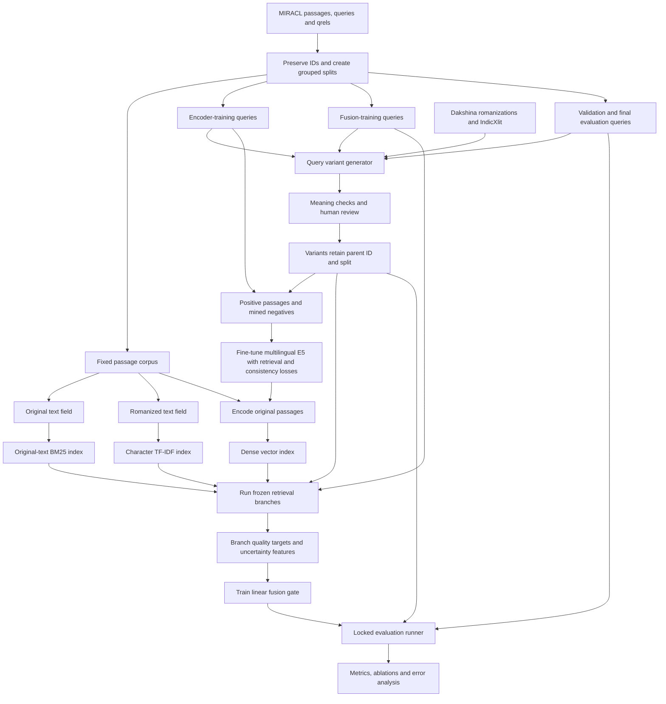
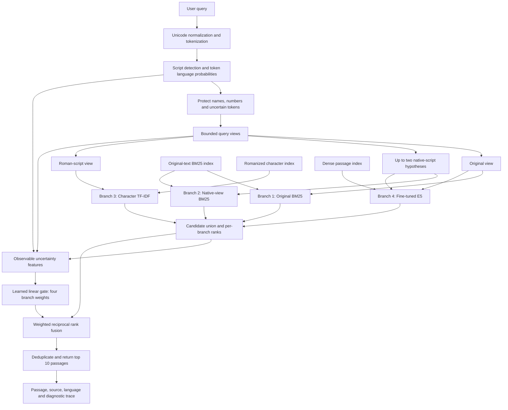

# Uncertainty-Aware Multi-View Retrieval for Noisy English–Hindi–Bengali Queries

## Purpose and status

This document consolidates the project discussion into a self-contained implementation handoff for Codex. It preserves the proposed method, both architecture diagrams, dataset strategy, equations, experiments, expected outcomes, and coding instructions. It is a structured specification rather than a verbatim chat transcript.

**Status:** proposed research design; implementation, model training, dataset download, and experimental evaluation have not yet been performed. Numerical targets are aspirations, not measured results. Sources were checked during the project discussion on 9 October 2026; verify actual access, licenses, and schemas before implementation.

## 1. Original problem statement and requirements

> Information Retrieval for Noisy and Code-Mixed Indian Language Queries: Develop a search system that can understand and retrieve relevant information from Indian language queries (English, Hindi, Bengali), even when users mix languages, use different scripts, or make spelling variations.

The course project must include classical machine learning, deep learning, and NLP. It should be research-oriented, with a testable contribution and controlled experiments, rather than only a search application. The architecture must be detailed enough to guide implementation.

The proposed system preserves the original query, generates a bounded number of plausible interpretations, retrieves through complementary branches, and learns how much to trust each branch.

Important qualifications:

- Relevant datasets exist, but no single verified dataset covers every requested language, code-mixing pattern, script, noise type, and relevance label.
- Combining BM25, embeddings, and learned fusion is not in itself novel. Related work already uses these components.
- The candidate research contribution concerns transliteration ambiguity, protected tokens, robustness training, and uncertainty-aware fusion. Publication-level novelty requires a fuller literature review.

## 2. Scope and observable behavior

**Input:** a text query.

**Output:** top-ranked passages with passage text, source, language, and optional diagnostic information about query views and branch contributions.

| Query condition | Example |
|---|---|
| English | `What causes earthquakes?` |
| Hindi | `भूकंप क्यों आते हैं?` |
| Bengali | `ভূমিকম্প কেন হয়?` |
| Romanized Hindi | `bhukamp kyu aate hain` |
| Romanized Bengali | `bhumikompo keno hoy` |
| Hindi–English mixing | `earthquake kyu aate hain` |
| Bengali–English mixing | `earthquake keno hoy` |
| Mixed script | `earthquake क्यों आते हैं` |
| Spelling noise | `earthquke kyu ate hain` |

Distinguish three tasks:

1. **Multilingual retrieval:** supporting queries in multiple languages.
2. **Code-mixed retrieval:** handling multiple languages within one query.
3. **Cross-lingual retrieval:** retrieving passages in a language different from the query.

The architecture can support all three. Evaluate cross-lingual retrieval separately because monolingual relevance judgments do not establish relevance for passages in other languages. Begin with language-specific corpus tracks. A pooled multilingual index may be used in the demo, but rigorous pooled evaluation requires appropriate additional judgments.

Core exclusions: answer generation, voice input, personalization, web crawling, and a large production interface. These are not needed to test the research question.

## 3. Dataset strategy

| Resource | Contents and role | Limitation |
|---|---|---|
| MIRACL | Wikipedia passages, queries, relevance judgments; English, Hindi, Bengali; main retrieval benchmark | Not a ready-made noisy code-mixed benchmark |
| CMIR | Bengali–English code-mixed queries/documents with relevance judgments; external realistic evaluation | One language pair; access procedure applies |
| Dakshina | Native-script text, attested romanizations, sentence pairs including Hindi/Bengali; realistic spelling alternatives | No retrieval relevance labels |
| IndicXlit | Native/Roman transliteration models supporting Hindi/Bengali; query-view generation | Component, not retrieval benchmark |

Official links:

- MIRACL: https://github.com/project-miracl/miracl
- CMIR: https://cmir-iitbhu.github.io/cmir/
- CMIR access: https://cmir-iitbhu.github.io/cmir/dataset.html
- Dakshina: https://github.com/google-research-datasets/dakshina
- IndicXlit: https://github.com/AI4Bharat/IndicXlit

The CMIR access page requests a completed data-access form. Do not make access to it a dependency for completing the project. Never fabricate access or labels.

MIRACL counts reported by its repository:

| Language | Training queries | Development queries | Corpus passages |
|---|---:|---:|---:|
| English | 2,863 | 799 | 32,893,221 |
| Hindi | 1,169 | 350 | 506,264 |
| Bengali | 1,631 | 411 | 297,265 |

### Reduced-corpus starting configuration

Use a fixed corpus of approximately 50,000 passages per language initially:

1. Include all supplied judged passages for the selected queries.
2. Fill the remaining budget with reproducibly sampled distractors.
3. Preserve passage IDs, original text, title, and relevance judgments.
4. Use the identical corpus across all compared systems.
5. Record corpus membership, sampling seed, dataset version, and preprocessing configuration.
6. Label results as reduced-corpus experiments, not full MIRACL benchmark scores.

If required judged passages exceed the target size, increase the corpus size rather than silently dropping them. Full Hindi/Bengali corpus experiments are a later extension. The English corpus has a much larger indexing budget.

Selecting a benchmark corpus using supplied judgments must be documented. Evaluation labels may be used for this fixed benchmark construction and final scoring, but must not influence model training, negative mining for training, or hyperparameter selection.

## 4. Robustness benchmark construction

Generate controlled variants of original queries:

| Variant | Intended challenge |
|---|---|
| Original | Clean-reference performance |
| Romanized | Script mismatch |
| Code-mixed | Language switching |
| Mixed script | Script switching within a query |
| Typo-only | Character-level noise |
| Code-mixed plus noisy | Combined difficulty |

For Hindi/Bengali, prefer attested romanization alternatives from Dakshina where possible. Generate code-mixing through phrase-level substitutions reviewed by fluent speakers, not arbitrary token substitution. For English, use typographic noise and fluent-speaker-validated bilingual rewrites.

**Split original queries before generating variants. Every variant of an information need stays in the same partition.** Group duplicate or closely related information needs before splitting.

Preserve named entities, numbers, dates, negation, question intent, and relevance to the original positive passage. A variant inherits qrels only when meaning is unchanged. Mark unreviewed variants explicitly and reject invalid variants.

Add a human-written challenge set, initially 100–150 information needs with independently written Hindi–English and Bengali–English variants. Writers should express the intent naturally without copying the relevant passage's wording. A second fluent speaker verifies meaning. Record authorship/review metadata without exposing unnecessary personal data.

Keep synthetic and human-written results separate. Success on synthetic typos alone is insufficient evidence of natural-query robustness. Record noise severity and transformation provenance for each variant.

## 5. Research question and candidate contribution

> Can preserving multiple query interpretations and learning their reliability improve retrieval under spelling and script uncertainty without substantially harming clean-query performance?

A Roman token such as `kal` may have multiple language or contextual interpretations. Forced rewriting can damage valid queries, particularly names and ambiguous words.

Proposed components:

1. **Multiple views:** preserve original text, plausible native-script hypotheses, and a Roman-script representation.
2. **Semantic invariance training:** teach an encoder that meaning-preserving variants should retrieve the same passage.
3. **Query-dependent fusion:** learn the usefulness of exact, character, and semantic retrieval from observable uncertainty features.

Do not claim that multi-view retrieval, augmentation, consistency training, or adaptive fusion are individually new. The research claim must be narrower and supported by comparisons and ablations.

## 6. Architecture A: offline preparation and training

The following Mermaid source is part of the specification and can be read directly by Codex or rendered by a Mermaid-compatible Markdown viewer.



### Diagram interpretation and implementation constraints

- The shared variant-store node represents partitioned data, not permission to combine splits. The encoder reads only encoder-training variants; gate training reads only fusion-training variants; validation/final evaluation remain isolated.
- The diagram groups validation and evaluation visually; they must be distinct stored partitions and execution modes.
- The evaluation runner uses the frozen complete retrieval pipeline and its indexes, not just the gate.
- Train the token language identifier separately using auxiliary token labels. Its validation labels must not be taken from final evaluation.
- Fit corpus-level unsupervised indexes on the fixed retrieval corpus; keep supervised query labels partitioned.
- Re-encode passages whenever the document encoder changes. Never search a vector index built with an incompatible encoder checkpoint.

## 7. Architecture B: inference for a new query



Both BM25 branches search the same original-text index using different query views. Two duplicate indexes are not required.

Start with 100 candidates per branch. For a multi-view branch, retrieve per view, combine within the branch, and retain its top 100. The union therefore contains at most 400 passages. Log the number of searches and intermediate candidates too; the final union size does not capture total computational cost.

Deduplicate identical query views. Mask unavailable branches and renormalize fusion weights. When a query has no distinct native-script rewrite, avoid double-counting the original BM25 list. Treat these as explicit implementation safeguards and apply consistently across baselines.

## 8. Module details

| Module | Starting implementation | Role |
|---|---|---|
| Text preparation | Unicode NFC; script-aware tokenization; preserve meaningful marks | NLP preprocessing |
| Token language identification | Character 2–5-grams, neighbor features, logistic regression | Classical supervised ML |
| Transliteration | IndicXlit on plausible Hindi/Bengali spans; bounded alternatives | NLP and pretrained deep learning |
| Exact retrieval | BM25 over title and passage | Classical IR baseline |
| Spelling-tolerant retrieval | Character 3–5-gram TF-IDF over Romanized text | Partial spelling matches |
| Semantic retrieval | Fine-tuned multilingual E5 bi-encoder | Trainable deep learning |
| Fusion | Linear softmax gate over engineered features | Learned classical decision layer |
| Evaluation | Ranked metrics, slices, ablations, confidence intervals | Research evidence |

### Language identification

Predict token labels English, Hindi, Bengali, Other/uncertain. Script detection is evidence, not a definitive language decision. Roman script does not imply English. Dakshina words can provide weak language supervision, but isolated-word training does not represent all code-mixed queries. Add manually labeled query tokens for validation and ambiguity analysis.

Preserve uncertain tokens. Use surrounding-token context and retain alternatives rather than forcing a language assignment. Any probability calibration must use training/validation data only.

### Normalization and query views

- Preserve an exact original query alongside normalized processing text.
- Avoid aggressive stopword removal, stemming, or spelling correction in the initial version.
- Preserve negation, numbers, dates, and names. Name detection is imperfect; make the protection policy explicit and evaluate failures.
- Transliteration changes script; it does not translate English words. Native-script hypotheses may legitimately retain English tokens.
- Bound the number of hypotheses to prevent combinatorial expansion.
- Transform corpus and query Romanized views with compatible normalization settings.

### Semantic model

Starting checkpoint: `intfloat/multilingual-e5-small`.

- Query input prefix: `query: `.
- Passage input prefix: `passage: `.
- Use L2-normalized embeddings and inner-product search.
- Fine-tune the encoder; merely using frozen embeddings is not the proposed deep learning research contribution.
- Record the checkpoint revision and preprocessing configuration.
- Define a long-passage truncation/chunking policy consistent with the model's stated 512-token limit. If chunking is used, map chunks to original passage IDs before evaluation.

The official model card reports supervised training on MIRACL training data. Call the frozen model an off-the-shelf pretrained baseline, not an unseen-dataset or zero-shot MIRACL baseline.

Model source: https://huggingface.co/intfloat/multilingual-e5-small

## 9. Neural training objective

Let q be the original query, q-tilde a verified meaning-preserving variant, d+ a relevant passage, N_q the negatives, e the query embedding, and s cosine similarity.

Contrastive retrieval loss:

$$
\mathcal L_{\mathrm{ret}}(q) = -\log\frac{\exp(s(q,d^+)/\tau)}{\exp(s(q,d^+)/\tau)+\sum_{d^-\in N_q}\exp(s(q,d^-)/\tau)}
$$

Consistency loss:

$$
\mathcal L_{\mathrm{cons}} = 1-\cos(e(q),e(\tilde q))
$$

Combined objective:

$$
\mathcal L = \mathcal L_{\mathrm{ret}}(q)+\mathcal L_{\mathrm{ret}}(\tilde q)+\lambda\mathcal L_{\mathrm{cons}}
$$

Both query versions must retrieve the relevant passage while their embeddings remain close. Retrieval supervision prevents consistency alone from encouraging collapsed representations.

Tune lambda on validation data, including lambda = 0 as an ablation. The equation shows one positive; correctly handle multiple known positives in implementation and never use another known positive as a negative.

Start with random/in-batch negatives, then add difficult negatives retrieved by BM25 or a frozen dense baseline. Prefer judged nonrelevant passages where available. Unjudged mined candidates may be false negatives; exclude known positives and audit a sample. Mine training negatives using training queries only.

## 10. Adaptive fusion

Do not directly add raw BM25, TF-IDF, and cosine scores because their scales differ.

### Within a multi-view branch

Deduplicate query views, retrieve per view, and average reciprocal-rank contributions:

$$
A_m(q,d)=\frac{1}{|V_m(q)|}\sum_{v\in V_m(q)}\frac{\mathbf 1[d\in L_{m,v}(q)]}{k_{\mathrm{view}}+r_{m,v}(q,d)}
$$

Rank passages by A_m and retain the branch's candidate budget. Missing results contribute zero. Use an explicit deterministic tie-breaker. This averaging prevents arbitrary score inflation from generating more views.

### Across four branches

$$
S(q,d)=\sum_{m=1}^{4}\frac{w_m(q)\,\mathbf 1[d\in L_m(q)]}{k+r_m(q,d)}
$$

L_m is branch m's list, r_m is its 1-based passage rank, and w_m is its query-dependent weight. Start k at 60 and select final settings on validation queries. The weights of active branches sum to one.

Linear gate:

$$
w(q)=\operatorname{softmax}(W x(q)+b)
$$

| Feature group | Examples |
|---|---|
| Script composition | Latin, Devanagari, Bengali character proportions |
| Language ambiguity | Mean token-label entropy; uncertain-token fraction |
| Query structure | Length; estimated language switches |
| Rewrite magnitude | Fraction of changed tokens; normalized edit distance |
| Preservation | Protected-token changes or attempted changes |
| Retrieval agreement | Top-10 overlap across original and rewritten views |
| Branch evidence | Within-branch score gaps/dispersion |

If protected tokens never change by design, their changed-token count is constant and should be dropped or replaced with a nonconstant feature such as attempted rewrites. Transliteration beam scores are features, not automatically calibrated probabilities. Standardize continuous features using fusion-training statistics only.

### Gate training

1. Freeze the trained encoder and all retrieval indexes.
2. Run branches on the separate fusion-training partition.
3. Compute each branch's nDCG@10 against fusion-training qrels.
4. Convert branch utilities u_m to soft targets, for example t_m = softmax(u_m / T), using a configurable positive temperature T.
5. Fit the linear softmax gate using cross-entropy to these targets.
6. Handle inactive branches consistently; queries on which no branch retrieves a relevant result provide no useful preference and may be excluded with a recorded policy.
7. Select hyperparameters on validation queries.

Relevance judgments create targets only. Inference uses observable query and retrieval features, never true relevance or true branch quality. Utility-target training is a surrogate for final fused ranking quality; assess actual fused nDCG on validation data.

Compare against both equal-weight fusion and validation-tuned fixed weights. Equal weights alone are an insufficient adaptive-fusion baseline.

## 11. Splits and leakage control

| Partition | Purpose |
|---|---|
| Approximately 70% of official training query groups | Encoder training |
| Approximately 15% | Fusion training |
| Approximately 15% | Hyperparameter selection |
| Official development queries | Locked final project evaluation |

Stratify by language and group duplicates/closely related information needs before splitting. Generate variants afterward. Store the split assignment at parent-query level and assert that it is respected throughout the pipeline.

Call the final evaluation "held-out MIRACL development evaluation," not the official test set. If the method changes after observing that set, disclose that it is no longer untouched.

E5's prior MIRACL training means internal partitions of MIRACL train are not unseen with respect to pretraining. Disclose that limitation. Keep the official held-out evaluation and an independent human-written challenge set for final assessment.

## 12. Experiments and ablations

| ID | System | Research purpose |
|---|---|---|
| B1 | Original-query BM25 | Exact matching baseline |
| B2 | Romanized character TF-IDF | Character robustness |
| B3 | Off-the-shelf E5 | Existing semantic capability |
| B4 | Single-best normalization plus BM25/E5 | Benefit and harm of forced rewriting |
| B5 | Multi-view fixed-weight fusion | Value of combining views and branches |
| B6 | Noise-trained E5 plus fixed fusion | Augmentation benefit |
| P1 | Noise-trained E5 plus consistency and fixed fusion | Incremental consistency benefit |
| P2 | Full system with uncertainty-aware gate | Incremental adaptive-fusion benefit |

B4 should be implemented as clearly named normalized-BM25 and normalized-E5 runs, with any combined variant documented separately.

Remove these components individually from the full method:

- Original-query preservation.
- Character retrieval.
- Consistency loss.
- Uncertainty features.
- Retrieval-agreement features.
- Adaptive weights.

Keep corpus composition and candidate budgets comparable. Log actual retrieval calls and latency, including view-generation cost. For trained methods, use multiple seeds if practical; do not rerun deterministic baselines unnecessarily.

## 13. Evaluation metrics

| Metric | Interpretation |
|---|---|
| nDCG@10, primary | Ranking quality among first ten results |
| MRR@10 | Position of first relevant result |
| Recall@100 | Relevant passages reaching the candidate set |
| Clean-to-noisy performance drop | Robustness to corruption |
| Normalization harm rate | Fraction of query groups harmed by rewriting |
| Latency and index size | Resource cost |

Define normalization harm rate with a fixed comparator and metric, e.g. fraction of queries whose nDCG@10 after rewriting is lower than original-query nDCG@10 under the same retriever. Do not mix this metric with end-to-end system improvement.

Report separate slices for languages, noise types, ambiguity levels, entities/negation, and synthetic versus human-written queries. Macro-average languages to avoid English dominating. Bootstrap by original query group, not individual variants, because variants are correlated.

Qrels may be incomplete. Use standard evaluation conventions and report their limitations; do not equate every unjudged document with known irrelevance in qualitative claims.

## 14. Expected results and honest reporting

These are hypotheses, not results:

| Condition | Plausible outcome to test |
|---|---|
| Clean exact-term queries | BM25 remains competitive |
| Minor Roman spelling changes | Character retrieval improves coverage |
| Vocabulary mismatch | Dense retrieval helps |
| Straightforward romanization | Native-script views help |
| Ambiguous tokens/names | Forced normalization sometimes hurts |
| Combined mixing/noise | Multi-view retrieval may improve robustness |
| Clean queries after heavy augmentation | Possible accuracy trade-off |

A convincing outcome is higher noisy-query nDCG@10 than the strongest fixed-fusion baseline, fewer harmful normalization cases, and limited clean-query regression.

An aspirational target is 5–10% relative noisy-query improvement while remaining within about 0.01 absolute clean nDCG@10 of the strongest clean baseline. These values are goals, not forecasts or acceptance criteria that justify changing reported data. A change from 0.40 to 0.44 is 10% relative and 0.04 absolute.

If adaptive fusion does not beat tuned fixed fusion, report it and analyze insufficient data, unreliable features, or correlated retriever errors. Negative results remain valid research evidence.

## 15. Suggested source layout

| Path | Responsibility |
|---|---|
| `data/prepare_corpus.py` | Fixed corpus, IDs, provenance |
| `data/make_splits.py` | Grouped stratified split manifests |
| `data/generate_variants.py` | Variant generation and provenance |
| `nlp/language_id.py` | Token language probabilities |
| `nlp/query_views.py` | Protected normalization and hypotheses |
| `retrieval/bm25.py` | Original/native-view lexical retrieval |
| `retrieval/char_tfidf.py` | Romanized character matching |
| `retrieval/dense.py` | Embeddings and vector search |
| `training/train_encoder.py` | Retrieval and consistency training |
| `training/train_gate.py` | Gate features, targets, fitting |
| `retrieval/fusion.py` | Within-branch and final fusion |
| `evaluation/evaluate.py` | Metrics, slices, bootstrap, ablations |
| `app.py` | Minimal demonstration interface |
| `README.md` | Installation, data preparation, run commands |
| `PROGRESS.md` | Completed work, limitations, next steps |

This layout is a starting proposal. Codex may refine package organization while preserving responsibilities.

### Data contracts

| Record | Required fields |
|---|---|
| Passage | `doc_id`, `language`, `title`, `text`, `romanized_text`, `source` |
| Query | `query_id`, `parent_query_id`, `text`, `languages`, `split`, `variant_type`, `verified` |
| Qrel | `query_id`, `doc_id`, `relevance` |
| Retrieval result | `query_id`, `doc_id`, `branch`, `rank`, `score` |

Prefix document IDs with the corpus language in pooled collections to avoid collisions. Add metadata for dataset version, transformation, noise severity, model revision, seed, configuration hash, and judgment provenance as needed.

## 16. Implementation order and completion checks

1. **Data loader, corpus manifest, grouped splits, qrels, evaluator.** Verify IDs, labels, and split isolation with a tiny explicit fixture.
2. **BM25, character TF-IDF, and frozen E5 baselines.** Produce reproducible result files on a documented real-data subset.
3. **Query variants and robustness measurements.** Record review status; establish clean/noisy baseline performance.
4. **Protected views and fixed fusion.** Inspect ambiguous-token cases and validate bounded candidate counts.
5. **Noise-aware encoder fine-tuning.** Save checkpoints/configuration and regenerate compatible document embeddings.
6. **Consistency objective and adaptive gate.** Use the designated partitions and compare to fixed fusion.
7. **Ablations, human challenge set, final evaluation, error analysis.** Keep final evaluation locked until the method is fixed.
8. **Minimal interface.** Display top passages, source/language, selected query views, and diagnostic contributions.

Tests should focus on consequential risks: grouped leakage, metric correctness on known rankings, ID mapping, mask/weight normalization, duplicate views, and encoder-index compatibility. Distinguish small fixture checks from actual retrieval experiments.

## 17. Codex handoff

Save this file at the repository root as `PROJECT_SPEC.md`. Open Codex in that project folder, or commit the file to the repository used by a remote Codex task. Preserve this UTF-8 Markdown source, including Mermaid blocks and equations.

### Starting prompt

```text
Read PROJECT_SPEC.md completely, including both Mermaid architecture
diagrams, equations, dataset requirements, training objectives,
evaluation protocol, and implementation order.

Build the research project described there. Preserve its classical ML,
deep learning, and NLP components.

First inspect the repository and available hardware. Identify technical
inconsistencies or missing implementation details, explain necessary
corrections, and record reasonable assumptions.

Create an implementation plan, then begin coding the first milestone:
dataset loading, reproducible grouped splits, corpus preparation,
relevance judgments, evaluation metrics, and a runnable BM25 baseline.

Keep the architecture extensible for character TF-IDF, multilingual E5,
query views, contrastive and consistency training, and adaptive fusion.

Prevent leakage between original queries and their variants. Keep final
evaluation data out of training and hyperparameter selection.

Distinguish fixture-based checks from real dataset experiments.
Never invent results or claim that training ran when it did not.

Document setup and execution commands in README.md, and maintain
PROGRESS.md with completed work, limitations, and next steps.
```

### Optional root AGENTS.md content

```markdown
# Project instructions

- Use PROJECT_SPEC.md for research scope, architecture, and evaluation decisions.
- Preserve query-group split isolation and final-evaluation separation.
- Preserve the classical ML, deep learning, and NLP components of the project.
- Record justified design changes and assumptions rather than silently changing the method.
- Never fabricate experiments, training completion, metrics, or dataset access.
- Keep reproducible commands in README.md and current status in PROGRESS.md.
```

The detailed methodology belongs in PROJECT_SPEC.md; keep AGENTS.md concise. Official guidance: https://learn.chatgpt.com/docs/agent-configuration/agents-md

## 18. References for implementation and related work

1. MIRACL official repository: https://github.com/project-miracl/miracl
2. MIRACL project site: https://project-miracl.github.io/
3. CMIR official task: https://cmir-iitbhu.github.io/cmir/
4. CMIR dataset/access procedure: https://cmir-iitbhu.github.io/cmir/dataset.html
5. Dakshina official repository: https://github.com/google-research-datasets/dakshina
6. IndicXlit official repository: https://github.com/AI4Bharat/IndicXlit
7. E5-small model card: https://huggingface.co/intfloat/multilingual-e5-small
8. Multilingual E5 technical report: https://www.microsoft.com/en-us/research/publication/multilingual-e5-text-embeddings-a-technical-report/
9. From Romanised to Relevant: Multistage Information Retrieval for Code-Mixed Multilingual Queries: https://ceur-ws.org/Vol-4173/T3-3.pdf
10. Query-Adaptive Hybrid Search: https://www.mdpi.com/2504-4990/8/4/91
11. Joint Approach to Deromanization of Code-mixed Texts: https://aclanthology.org/W19-1403/
12. FIRE 2025 working notes, including CMIR systems: https://ceur-ws.org/Vol-4173/

These references establish resources and related approaches; they do not establish that the proposed system will outperform them. Verify official code, licenses, data formats, dependency versions, and model usage before running the implementation.
